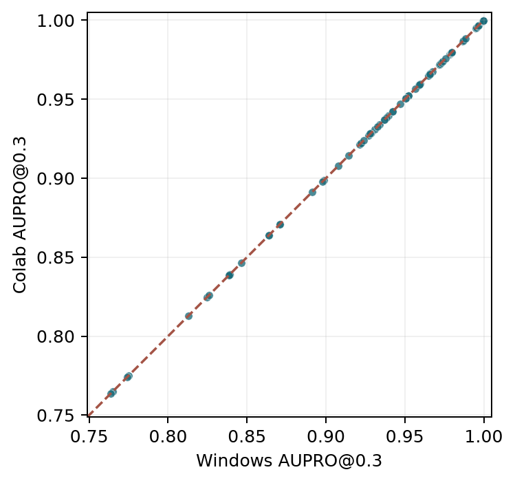

# Windows 與 Colab 實驗比較報告

更新日期：2026-11-13　｜　用途：組內討論，非正式英文交件檔

這份補充報告比較原本在 Windows 與 RTX 5060 上完成的 PatchCore 實驗，以及組員在 Google Colab 的重跑和延伸分析。兩份摘要在 81 個相同條件下幾乎重合；Colab 的主要貢獻，是讓我們看見低誤報要求與不同瑕疵大小下，原本結論的適用範圍。正式交件的英文報告另存，這份中文文件供組內討論與修改。

## 先看結論

Windows 與 Colab 的 AUPRO@0.3 平均值，在 81 個逐列配對的條件中，最大絕對差為 0.00002237。這支持 Colab 重跑與原實驗結果一致；它不能單獨證明整個訓練與執行過程完全相同，因為 GitHub 沒有收錄 Colab 的 81 份原始執行資料。

在小瑕疵的 AUPRO 評估裡，layer2 優於 layer3 的九個條件都成立。layer2 與 fusion 差距較小；換成較大瑕疵時，優勢常轉向 fusion。小於 64 像素的瑕疵區域，召回率也明顯低於較大區域。

## 實驗設計與可比性

兩份摘要都以同一組條件鍵（類別、輸入尺寸、特徵層、記憶庫預算、瑕疵分組）記錄結果；三個隨機種子也相同。這使準確度能逐列核對。資料集雜湊是按類別不同而有三個值，但每個配對條件的雜湊一致；study 程式雜湊在全部條件一致。

| 項目 | 比較內容 |
| --- | --- |
| 研究問題 | 以正常影像建立 PatchCore 記憶庫，找出 screw、capsule、metal_nut 影像中的異常位置。 |
| 原實驗 | Windows 11、RTX 5060；完成 81 個彙整條件，使用 seeds 0、1、2。 |
| 組員實驗 | Google Colab 的 CUDA 環境；依相同資料、程式與設定重跑 81 個條件，再從已存預測結果計算新指標。 |
| 共同條件 | 224／320 像素，layer2／layer3／fusion，10% 記憶庫與固定 4096 patch 記憶庫；依 all、small、large 分組。 |
| 可比較的結果 | AUPRO@0.3、Pixel AUROC、Image AUROC 與記憶庫大小。兩邊每列的資料雜湊與 study 程式雜湊相同。 |
| 不可直接比較 | 推論延遲。Colab 使用另一套硬體與執行環境，計時不能拿來判定 RTX 5060 與 Colab GPU 的速度高低。 |

## 原指標重跑結果

下表的「最大差」與「平均差」都是 81 列配對後的絕對差。這些差距遠小於通常用來討論模型差異的幅度，對原報告的主要準確度趨勢沒有實質影響。

| 指標 | 最大絕對差 | 平均絕對差 |
| --- | --- | --- |
| AUPRO@0.3 | 0.00002237 | 0.00000255 |
| Pixel AUROC | 0.00001295 | 0.00000082 |
| Image AUROC | 0.00020670 | 0.00000508 |

圖 1　每一點代表一個相同條件；虛線是兩邊完全相等的位置。

## 小瑕疵的直接對照

下表固定使用 10% 記憶庫，只列原報告最關心的 small 組。數字是三個種子的 AUPRO@0.3 平均值；四捨五入到小數四位後，Windows 與 Colab 完全一致。layer2 與 fusion 的差別要看類別和尺寸，不能只用一個總平均概括。

| 類別 | 尺寸 | Windows L2 | Colab L2 | Windows 融合 | Colab 融合 |
| --- | --- | --- | --- | --- | --- |
| screw | 224 | 0.9658 | 0.9658 | 0.9651 | 0.9651 |
| screw | 320 | 0.9797 | 0.9797 | 0.9794 | 0.9794 |
| capsule | 224 | 0.9741 | 0.9741 | 0.9722 | 0.9722 |
| capsule | 320 | 0.9870 | 0.9870 | 0.9867 | 0.9867 |
| metal_nut | 224 | 0.9956 | 0.9956 | 0.9955 | 0.9955 |
| metal_nut | 320 | 0.9967 | 0.9967 | 0.9963 | 0.9963 |

## 新增指標改變了哪些解讀

組員從已保存的預測分數計算更嚴格的 AUPRO、Pixel AP、pointing accuracy 與區域召回率；沒有重新訓練模型。比較層數時，分母 9 是三種類別乘上三種尺寸／記憶庫設定（224／10%、320／10%、224／4096）；比較解析度時，分母 9 是三種類別乘上三種特徵層。「成立」只是平均值的方向，並不等於每個比較都達統計顯著。

| 指標 | 小瑕疵 L2≥融合 | 大瑕疵 L2≥融合 | 小瑕疵 L2>L3 | 小瑕疵 320>224 |
| --- | --- | --- | --- | --- |
| AUPRO@0.3 | 8/9 | 1/9 | 9/9 | 9/9 |
| AUPRO@0.01 | 8/9 | 3/9 | 9/9 | 9/9 |
| Pixel AP | 9/9 | 5/9 | 9/9 | 9/9 |
| 區域召回率@1% FPR | 8/9 | 4/9 | 7/9 | 5/9 |

## 很小的瑕疵仍難定位

在正常像素誤報率設為 1% 的門檻下，將區域按面積分組後，小於 64 像素的設定平均召回率是 0.782；64 像素以上各組約為 0.950 或更高。表內平均值是各設定的簡單平均，不是把所有區域合併後計算；同一批影像會在多個設定中重複出現，因此設定數也不是獨立樣本數。

| 瑕疵區域面積（像素） | 設定數 | 平均區域召回率 |
| --- | --- | --- |
| 小於 64 | 27 | 0.782 |
| 64–255 | 27 | 0.950 |
| 256–1023 | 27 | 0.986 |
| 至少 1024 | 21 | 1.000 |

## 不確定性與限制

組員以每個 seed 的影像做 2,000 次成對 bootstrap。45 個可計算的小組中，pointing@8px 的 95% 信賴區間有 43 個包含 0；區域召回率則有 45 個包含 0。這表示 layer2 與 fusion 在這兩項指標上的差距，多數情況仍不足以作穩健的勝負判斷。

metal_nut 的小瑕疵只有 7 張異常圖，screw 的大瑕疵只有 1 張。這些子組的方向值得觀察，但不宜延伸成普遍結論。Colab 的 oracle pixel F1 使用測試 mask 選門檻，只能當診斷值；其餘新門檻沒有用測試 mask 調整。

原始 Colab 執行資料、log、資料集與模型權重存放於組員的 Google Drive，未進入 GitHub；本報告核對的是儲存庫中的摘要表、分析表與程式。Colab notebook 也清除了執行輸出。

## 組內可以怎麼使用

保留目前英文正式報告作為原實驗版本。若要把 Colab 分析納入交件版，建議加入一段重現檢查，並用一張表呈現嚴格 FPR 和瑕疵大小結果；同時同步更新英文 Word、PDF 與錄影簡報。報告中要把 AUPRO@0.3 的原始主結果和 Colab 新算的指標分開標示。

## 資料來源

- Windows 原結果：`results/summary_windows/mean_std.csv`
- Colab 重跑摘要：`colab_rerun/results/summary/mean_std.csv`
- 新指標、比較與 bootstrap：`colab_rerun/results/extended/`
- Colab 說明：`colab_rerun/README.md`；原實驗方法：`output/pdf/group6_patchcore_final_report.pdf`
